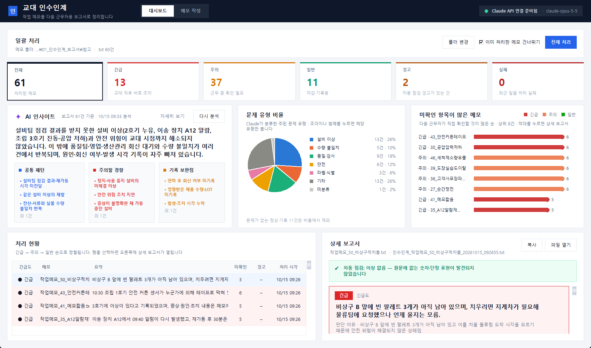
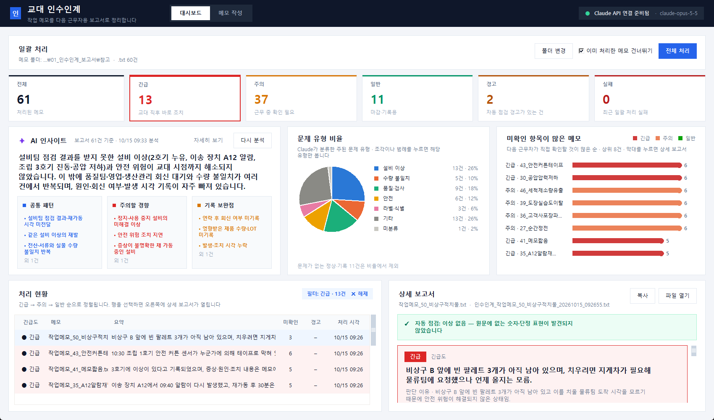
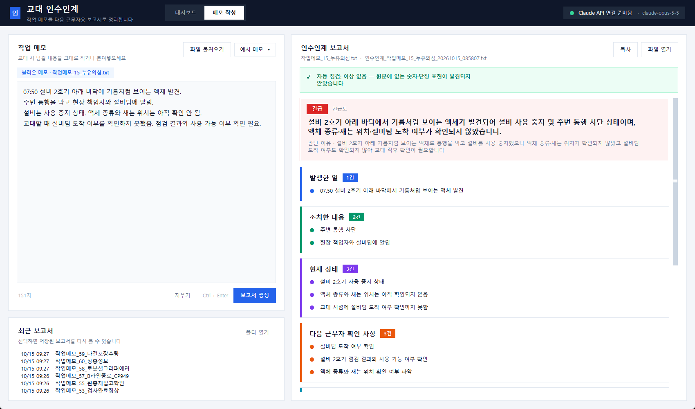

# 교대 인수인계 보고서 생성기

작업 메모를 Claude API(`claude-opus-5-5`)로 정리해 다음 근무자용 인수인계 보고서를 만듭니다. 보고서에는 **긴급도·한 줄 요약 / 발생한 일 / 조치한 내용 / 현재 상태 / 다음 근무자 확인 사항 / 시간순 경과 / 주요 수치·대상 / 연락·요청 현황 / 미확인 사항**이 들어갑니다. 메모에 없는 내용은 지어내지 않고 `미확인`으로 표시하며, 원문과 대조하는 자동 점검을 거칩니다.

폴더의 메모를 한 번에 처리하고, 긴급도순 대시보드·문제 유형 비율·AI 인사이트로 전체 현황을 볼 수 있습니다.

## 화면

**대시보드** — 요약 타일, AI 인사이트(여러 보고서의 공통 패턴·주의할 경향·기록 보완점), 문제 유형 비율, 미확인 항목이 많은 메모, 긴급도순 처리 현황과 상세 보고서



**필터** — 상단 `긴급`·`주의`·`일반`·`경고` 타일이나 원형 그래프 조각을 누르면 처리 현황이 해당 항목으로 걸러집니다



**메모 작성** — 메모 한 건을 입력하거나 불러와 보고서를 만들고, 항목별 카드로 확인합니다



## 1. 설치

```powershell
python -m pip install -r requirements.txt
```

Python 3.10 이상이 필요합니다.

## 2. API 키 설정

`.env.example`을 `.env`로 복사하고 키를 넣습니다. `.env`는 `.gitignore`에 들어 있어 git에 올라가지 않습니다.

```
ANTHROPIC_API_KEY=sk-ant-...
```

`ANTHROPIC_API_KEY` 환경변수가 설정되어 있으면 `.env`보다 우선합니다.

## 3. 실행 — 데스크톱 앱 (권장)

```powershell
python app.py
```

**대시보드** (첫 화면)

- `전체 처리`: 메모 폴더(기본 `참고/`)의 `.txt` 메모를 최대 4건씩 동시에 처리합니다. `폴더 변경`으로 다른 폴더를 고를 수 있고, `이미 처리한 메모 건너뛰기`가 켜져 있으면 같은 내용의 메모는 다시 처리하지 않습니다.
- 처리가 끝나면 Claude가 보고서 전체의 공통점을 분석해 **AI 인사이트**에 보여줍니다. `다시 분석`으로 직접 실행할 수도 있습니다.
- **문제 유형 비율**: 보고서마다 Claude가 분류한 주된 문제 유형의 비율입니다(정상·기록 건은 제외).
- **미확인 항목이 많은 메모**: 다음 근무자가 직접 확인할 것이 많은 순입니다. 막대를 누르면 상세 보고서가 열립니다.
- **처리 현황**: 긴급 → 주의 → 일반 순으로 정렬됩니다. 행을 선택하면 오른쪽에 상세 보고서가 열립니다.

**메모 작성**

- 메모를 적거나, `파일 불러오기` / `예시 메모 ▾`로 불러옵니다.
- `보고서 생성` (또는 `Ctrl + Enter`)을 누르면 오른쪽에 항목별 카드로 보고서가 표시되고 `reports/`에 자동 저장됩니다. 대시보드에도 바로 반영됩니다.
- `복사`로 보고서 텍스트를 클립보드에 복사, `파일 열기`로 저장 파일을 엽니다.

## 3-1. 실행 — 터미널

```powershell
# 메모를 직접 붙여넣기 (빈 줄에서 Enter 두 번으로 입력 끝)
python handover_report.py

# 메모 파일 하나
python handover_report.py --file 참고\작업메모_01_라벨이상.txt

# 폴더 안의 메모(.txt) 전부 (4건 동시), 끝에 긴급/주의/일반/실패 건수 출력
python handover_report.py --dir 참고

# 저장 폴더 지정
python handover_report.py --file 메모.txt --out 보고서
```

저장 파일: `reports/인수인계_<원본이름>_<YYYYMMDD_HHMMSS>.txt` (원문 메모가 보고서 끝에 함께 붙습니다)와 같은 이름의 `.json`(대시보드용)

## 4. 보고서 읽는 법

- `긴급도`: Claude가 메모 내용만 보고 판단한 등급과 이유
  - 긴급: 교대 직후 바로 조치 (안전 위험, 설비 정지·이상 미해결 등)
  - 주의: 근무 중 확인 필요 (판정·회신 대기, 출하·수량 영향 등)
  - 일반: 마감·기록용
- `- 메모에 기록 없음`: 메모에 그 항목에 해당하는 내용이 없음
- `- ○○: 미확인`: 메모에서 확인하지 못했다고 했거나, 기록이 없는 원인·수량·시각
- `※ 자동 점검 경고`: 프로그램이 원문과 대조해 의심스러운 부분을 찾은 것입니다.
  - 원문에 없는 숫자 (예: 메모에 없는 라벨 수량)
  - 원문에 없는 근거 문장
  - 원문에 없는 "해결/완료/정상화" 같은 단정 표현

  경고가 있으면 해당 문장을 원문 메모와 직접 대조하세요. 경고가 있어도 보고서는 저장됩니다.

## 5. 검증용 샘플 메모

`참고/`에 메모 60건이 있습니다(01~20 실습 자료, 21~60 검증용). 21~60번의 예상 긴급도와 확인할 점은 [docs/검증/샘플메모_예상결과.md](docs/검증/샘플메모_예상결과.md)에 있습니다.

## 6. 테스트

```powershell
python -m pytest
```

API를 호출하지 않는 테스트입니다.
